<a href="https://mahmud886.vercel.app">
  <picture>
    <source media="(prefers-color-scheme: dark)" srcset="./.github/readme/banner-dark.svg" />
    <source media="(prefers-color-scheme: light)" srcset="./.github/readme/banner-light.svg" />
    
  </picture>
</a>

<p align="center">
  <a href="https://mahmud886.vercel.app"></a>
  <a href="https://mahmud886.vercel.app/iqbal_mahmud_7_years.pdf"></a>
  <a href="https://www.linkedin.com/in/mahmud886/"></a>
  <a href="https://medium.com/@mahmud886"></a>
  <a href="mailto:iqbal886mahmud@gmail.com"></a>
</p>

<p align="center">
  Software engineer in Dhaka with <b>7+ years</b> of React, Next.js and TypeScript — from a UI used by <b>2M+ people a day</b>
  to <b>SaaS products I design and build end to end</b>: multi-tenant under the hood, beautifully animated on the surface.
</p>

<br />

```ts
const iqbal = {
  role: 'Software Engineer — Frontend & SaaS product engineering',
  based: 'Dhaka, Bangladesh 🇧🇩 · remote-friendly',
  now: ['Software Engineer @ Adventure Dhaka Limited', 'building PartsPilot, RestaurantOS & PureCart'],
  stack: ['React', 'Next.js', 'TypeScript', 'Tailwind', 'Node.js', 'PostgreSQL', 'Prisma', 'Supabase'],
  craft: ['multi-tenant SaaS', 'design systems', 'Core Web Vitals', 'GSAP & Three.js motion'],
  shipped: { products: '10+', dailyUsers: '2M+', emailTemplates: 300, animations: 100 },
  openTo: ['full-time roles', 'contracts', 'hard frontend problems'],
} as const;
```

## 🧩 SaaS I build

<table>
  <tr>
    <td width="50%" valign="top">
      <a href="https://mahmud886.vercel.app/projects/parts-pilot">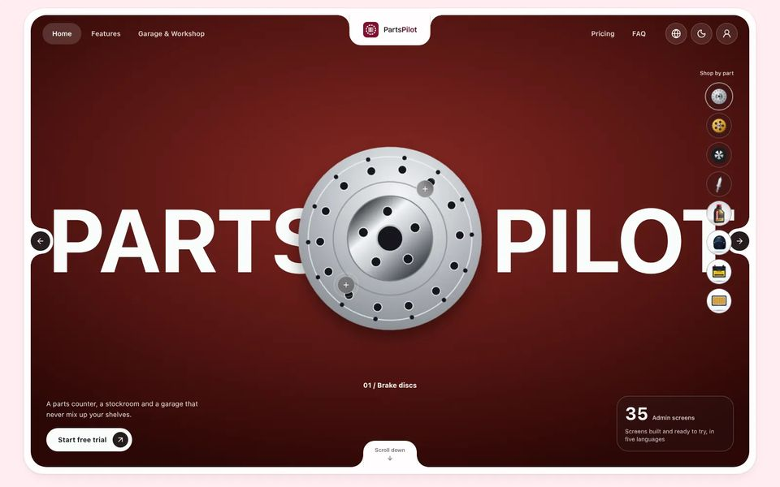</a>
      <h3><a href="https://mahmud886.vercel.app/projects/parts-pilot">PartsPilot</a> <sub><code>● LIVE BETA</code></sub></h3>
      <sub><b>Automotive parts ERP & marketplace</b></sub>
      <p>A parts counter, a stockroom and a garage on one live stock ledger — scanner-fast POS with bKash/Nagad, garage job board, inventory and an online marketplace with courier tracking.</p>
      <p><b>35</b> admin screens · <b>5</b> languages incl. Bangla & RTL Arabic · <b>380+</b> commits in 4 weeks</p>
      <sub><code>Next.js 16</code> <code>Prisma 7</code> <code>PostgreSQL</code> <code>next-intl</code> <code>TanStack Table</code></sub>
      <p><a href="https://mahmud886.vercel.app/projects/parts-pilot">Case study →</a> · <a href="https://parts-pilot-v1.vercel.app/">Live ↗</a></p>
    </td>
    <td width="50%" valign="top">
      <a href="https://mahmud886.vercel.app/projects/restaurant-os">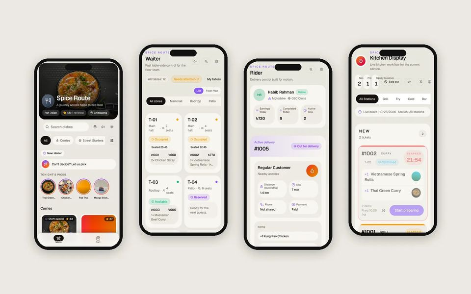</a>
      <h3><a href="https://mahmud886.vercel.app/projects/restaurant-os">RestaurantOS</a> <sub><code>● PRIVATE BETA</code></sub></h3>
      <sub><b>Multi-tenant restaurant SaaS</b></sub>
      <p>One QR code on the table: the menu, the order, the kitchen ticket and the bill. Guest QR ordering, owner hub, POS, kitchen display, waiter and rider apps, and a platform console.</p>
      <p><b>6</b> apps on one order · <b>14</b> pages in the owner hub · <b>18</b> technical specs</p>
      <sub><code>Next.js 16</code> <code>TypeScript</code> <code>Tailwind CSS</code> <code>Supabase</code></sub>
      <p><a href="https://mahmud886.vercel.app/projects/restaurant-os">Case study →</a> · <a href="https://restaurant-os-saas-v2.vercel.app/en">Live ↗</a></p>
    </td>
  </tr>
  <tr>
    <td width="50%" valign="top">
      <a href="https://mahmud886.vercel.app/projects/purecart">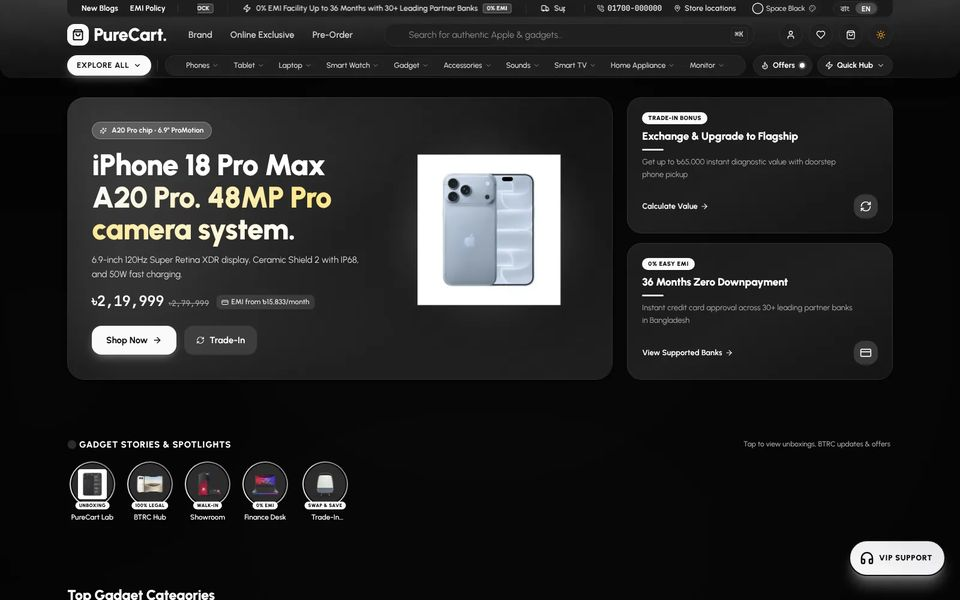</a>
      <h3><a href="https://mahmud886.vercel.app/projects/purecart">PureCart</a> <sub><code>FRONTEND COMPLETE</code></sub></h3>
      <sub><b>White-label gadget commerce platform</b></sub>
      <p>A storefront any electronics retailer can rebrand in a minute — EMI, trade-in valuation and IMEI checks, plus a 17-module merchant admin with POS, dispatch and a warranty desk.</p>
      <p><b>7</b> live themes · <b>17</b> admin modules · <b>64</b> delivery districts</p>
      <sub><code>Next.js 16</code> <code>React 19</code> <code>Zustand</code> <code>next-intl</code> <code>Vitest</code></sub>
      <p><a href="https://mahmud886.vercel.app/projects/purecart">Case study →</a></p>
    </td>
    <td width="50%" valign="top">
      <a href="https://mahmud886.vercel.app/projects/executive-fashion">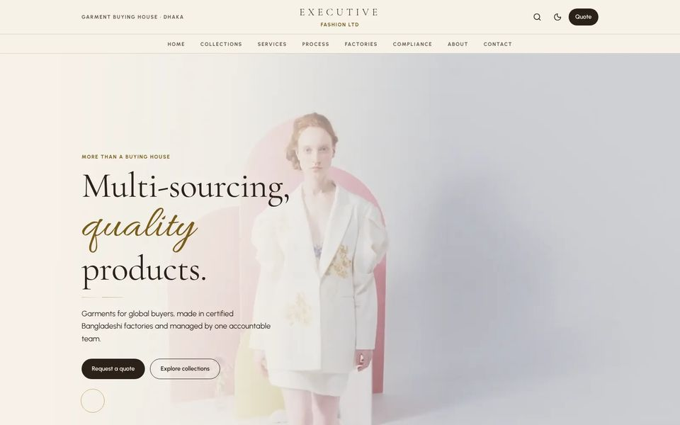</a>
      <h3><a href="https://mahmud886.vercel.app/projects/executive-fashion">Executive Fashion</a> <sub><code>DESIGN SIGN-OFF</code></sub></h3>
      <sub><b>Buying-house platform · CMS · RFQ → CRM</b></sub>
      <p>An editorial public site, a block CMS, an RFQ → CRM pipeline, production orders, factories and consent-based email marketing — built to be run by one person.</p>
      <p><b>101</b> design variants explored · <b>100%</b> tables behind RLS · <b>6</b> pipeline stages</p>
      <sub><code>Next.js 16</code> <code>Supabase</code> <code>Prisma</code> <code>Resend</code> <code>Zod</code></sub>
      <p><a href="https://mahmud886.vercel.app/projects/executive-fashion">Case study →</a></p>
    </td>
  </tr>
</table>

## 🏢 Client & team work

<table>
  <tr>
    <td width="33%" valign="top">
      <a href="https://mahmud886.vercel.app/projects/sporefall">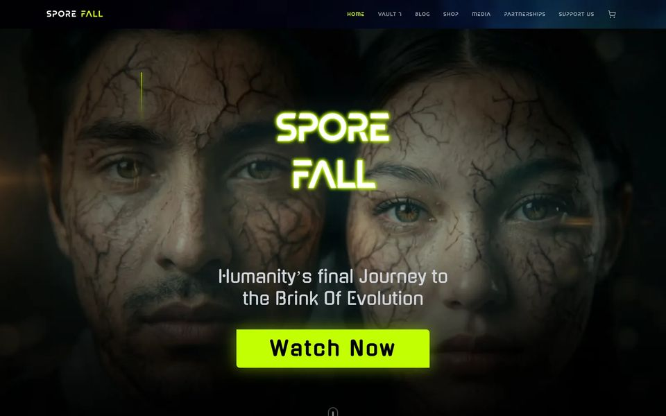</a>
      <h3><a href="https://www.sporefall.com/">Sporefall</a></h3>
      <sub><b>Gen-AI sci-fi micro-drama · Singapore</b></sub>
      <p>Audience-voted episodes, a Stripe merch store, an internal CMS and NEXUS — a drag-and-drop campaign builder shipped as one embed.js.</p>
      <sub><code>Next.js 16</code> <code>Supabase</code> <code>Stripe</code></sub>
    </td>
    <td width="33%" valign="top">
      <a href="https://mahmud886.vercel.app/projects/loud-spectrum">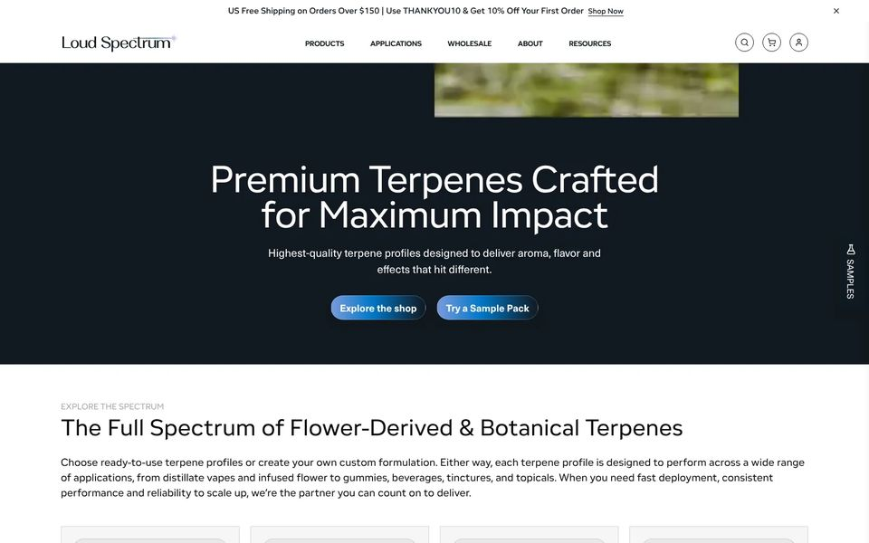</a>
      <h3><a href="https://loudspectrum.com/en">Loud Spectrum</a></h3>
      <sub><b>Production e-commerce · USA</b></sub>
      <p>B2B/B2C storefront for a terpene manufacturer: accounts, dynamic pricing rules and a Storybook design system — sub-second LCP.</p>
      <sub><code>Next.js</code> <code>Storybook</code> <code>PostgreSQL</code></sub>
    </td>
    <td width="33%" valign="top">
      <a href="https://mahmud886.vercel.app/projects/dev-visualize">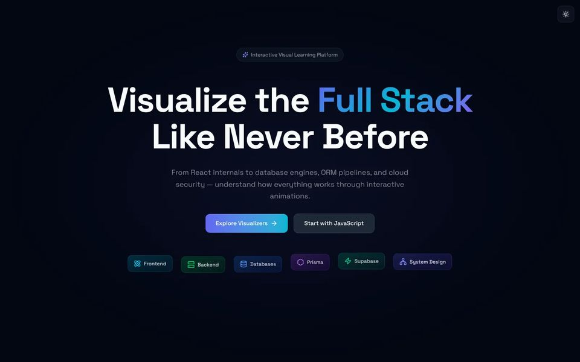</a>
      <h3><a href="https://dev-visualize.vercel.app/">Dev Visualize</a></h3>
      <sub><b>Interactive learning platform</b></sub>
      <p>12 animated visualizers, 75 sections and 400+ query examples that show how the web really works, step by step.</p>
      <sub><code>Next.js 16</code> <code>GSAP</code> <code>Three.js</code></sub>
    </td>
  </tr>
</table>

## 🧪 Now building

<table>
  <tr>
    <td width="33%" valign="top">
      <a href="https://mahmud886.vercel.app/projects/trading-docs">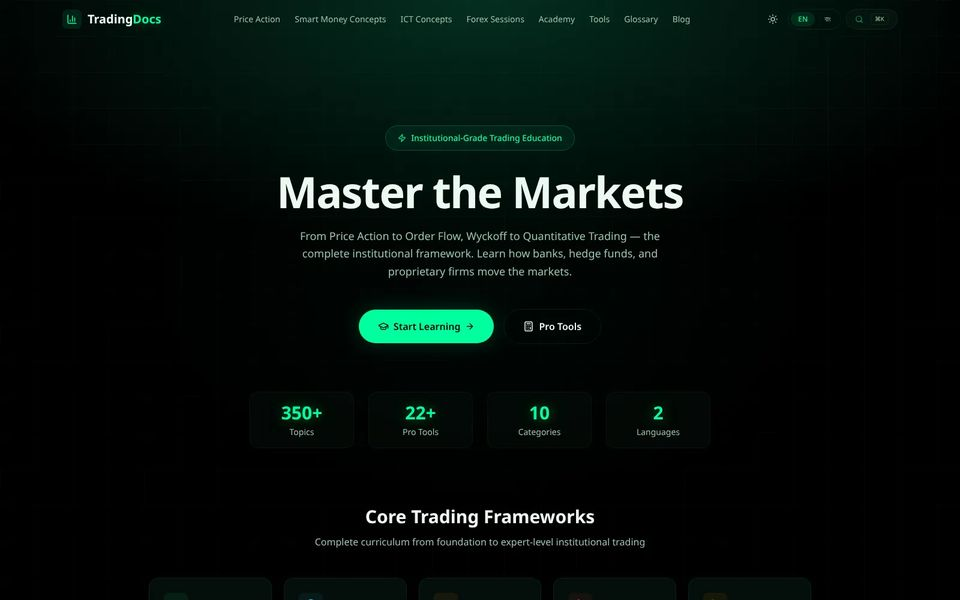</a>
      <b><a href="https://tradingdocs.vercel.app/">Trading Docs</a></b> <sub>· live</sub><br />
      <sub>306 trading topics in English & Bangla, 23 tools, fully offline PWA.</sub>
    </td>
    <td width="33%" valign="top">
      <a href="https://mahmud886.vercel.app/projects/devdock">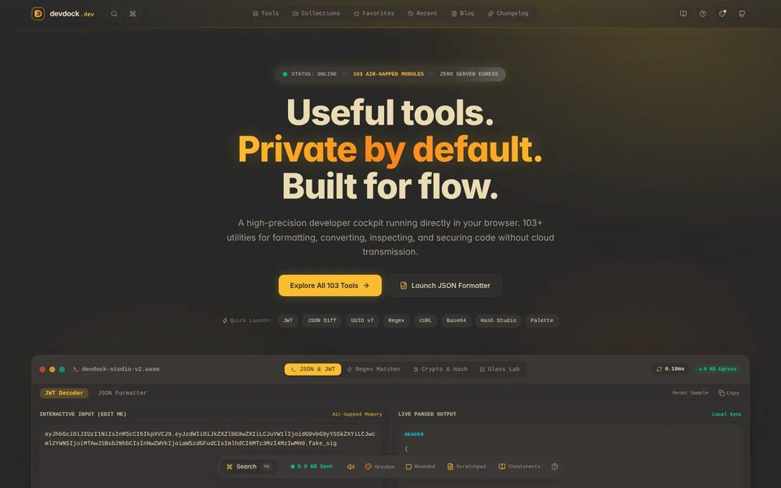</a>
      <b><a href="https://devdockdev.vercel.app/">devdock.dev</a></b> <sub>· live</sub><br />
      <sub>90+ developer tools that run in the browser — zero uploads, zero tracking.</sub>
    </td>
    <td width="33%" valign="top">
      <a href="https://mahmud886.vercel.app/projects/pulsar">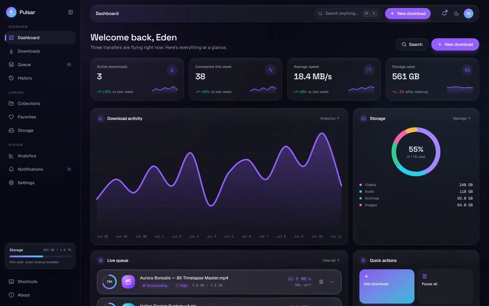</a>
      <b><a href="https://mahmud886.vercel.app/projects/pulsar">Pulsar</a></b> <sub>· UI complete</sub><br />
      <sub>A premium download-manager interface: 15 screens, six accents, light & dark.</sub>
    </td>
  </tr>
</table>

<sub>Also on the bench: <b>Finance Tracker</b> (budgets, loans, realtime) · <b>Noor</b> (Bangla-first Islamic companion) · <b>AVYRA</b> (one codebase, many storefronts) · <b>Khan Associates</b> (bilingual corporate site). <a href="https://mahmud886.vercel.app/#lab">See the lab →</a></sub>

## 💼 Experience

```diff
@@ git log --career --oneline @@
+ 2024 → now   Software Engineer   @ Adventure Dhaka Limited      design systems · SSR · testing · CI/CD
  2023 → 2024  Web Developer       @ Nexdecade Technology         2M+ daily users · +25% perf · -62% debugging time
  2021 → 2023  Web Developer       @ Hogarth Dhaka                300+ email templates · 100+ GSAP animations
  2021         Web Developer       @ Kaizen IT                    full-stack React · Node · MongoDB
  2021         Web Developer       @ Oxdora iTech                 first production websites
```

<sub>🎓 B.Sc. in Computer Science & Engineering — Southeast University · 📜 Reactive Accelerator (LWS) · Complete Web Development (Programming Hero) · <a href="https://mahmud886.vercel.app/resume">Full resume →</a></sub>

## 🧰 Toolbox

<p>
  <b>Frontend</b><br />
  
</p>
<p>
  <b>Motion & 3D</b><br />
  
  
  
</p>
<p>
  <b>Backend & data</b><br />
  
</p>
<p>
  <b>Quality & shipping</b><br />
  
</p>

## 📊 GitHub

<p align="center">
  <picture>
    <source media="(prefers-color-scheme: dark)" srcset="https://streak-stats.demolab.com?user=mahmud886&theme=transparent&hide_border=true&ring=F0F0EC&fire=F0F0EC&currStreakLabel=F0F0EC&sideLabels=F0F0EC&currStreakNum=F0F0EC&sideNums=F0F0EC&dates=9A9A95&stroke=3A3A38" />
    
  </picture>
</p>
<p align="center">
  <picture>
    <source media="(prefers-color-scheme: dark)" srcset="https://raw.githubusercontent.com/mahmud886/mahmud886/output/snake-dark.svg" />
    <source media="(prefers-color-scheme: light)" srcset="https://raw.githubusercontent.com/mahmud886/mahmud886/output/snake-light.svg" />
    
  </picture>
</p>

## ✍️ Latest writing

<!-- BLOG-POST-LIST:START -->
- [10 BASIC INTERVIEW QUESTIONS -- FLUID DESIGN AND VUE JS](https://medium.com/@mahmud886/10-basic-interview-questions-fluid-design-and-vue-js-7ddb2f4f02a3?source=rss-8e6ba8805fe7------2) <sub>· May 2020</sub>
- [10 JavaScript Coding Interview Questions Solve With Code](https://medium.com/swlh/10-javascript-coding-interview-questions-solve-with-code-3d0a22393a69?source=rss-8e6ba8805fe7------2) <sub>· May 2020</sub>
- [10 Days of JavaScript HackerRank Problem Solve](https://medium.com/@mahmud886/10-days-of-javascript-hackerrank-problem-solve-d5520b858c9d?source=rss-8e6ba8805fe7------2) <sub>· May 2020</sub>
- [REACT INTERVIEW QUESTIONS.](https://medium.com/@mahmud886/react-interview-questions-9ecc07d3a5ec?source=rss-8e6ba8805fe7------2) <sub>· May 2020</sub>
- [10 JAVASCRIPT INTERVIEW QUESTIONS](https://medium.com/@mahmud886/10-javascript-interview-questions-ee31a3c1a742?source=rss-8e6ba8805fe7------2) <sub>· May 2020</sub>
<!-- BLOG-POST-LIST:END -->

## 🤝 Let's build something good

I'm open to **full-time roles, contracts and hard frontend problems**. The fastest way to reach me is email — I reply within a day.

<p>
  <a href="mailto:iqbal886mahmud@gmail.com"></a>
  <a href="https://www.linkedin.com/in/mahmud886/"></a>
  <a href="https://discord.gg/Snigdho93"></a>
  <a href="https://www.facebook.com/snigdho121"></a>
</p>

<sub>This repo is also the source of my portfolio — Next.js 16 on Vercel. <a href="./docs/DEVELOPMENT.md">How it's built →</a> · </sub>
